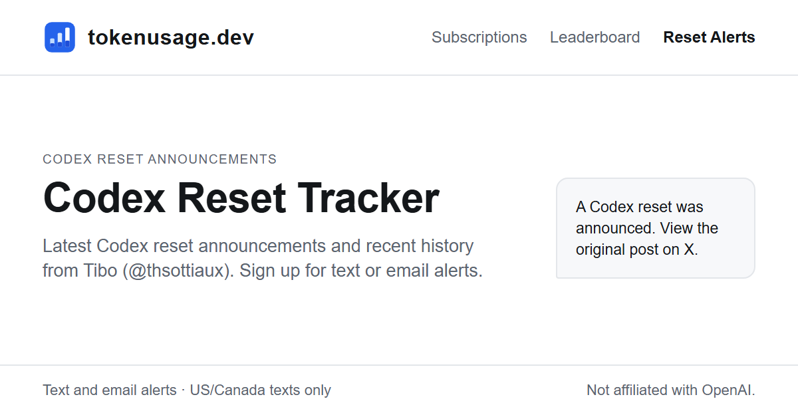

# Codex Reset Tracker MCP server

A hosted, read-only [MCP](https://modelcontextprotocol.io) server for OpenAI Codex usage-limit
resets, from [tokenusage.dev](https://tokenusage.dev/resets). Ask your agent whether Codex has
announced a reset, and it reads the record behind the
[Codex reset tracker](https://tokenusage.dev/resets).

[](https://tokenusage.dev/resets)

- Endpoint: `https://tokenusage.dev/mcp` (Streamable HTTP)
- No API key, no account, no sign-in
- Read-only: nothing runs on your machine and nothing is written

This repository holds client configuration only. The server is hosted at tokenusage.dev; its
fields, caching and limits are documented at
[tokenusage.dev/developers](https://tokenusage.dev/developers).

Nerf Watch has a separate read-only MCP server for public benchmark scores and history.
See [Nerf Watch installation and tools](nerfwatch/README.md).
A lower score is a lower score on this suite, not proof that a provider changed a model.
`Data: tokenusage.dev` linked to https://tokenusage.dev/nerfwatch.

## Tools

| Tool | What it returns |
|---|---|
| `get_codex_reset_announcements` | Codex usage-limit reset announcements by @thsottiaux on X, newest first (`limit` 1 to 50, default 10): each post's link, when it was posted, when tokenusage.dev recorded it and its `resetType` (`automatic`, `banked` or `both`; `null` for records older than reset types), plus when the monitor last checked X. |
| `get_codex_reset_calendar` | The same announcements grouped by UTC calendar date, newest first, at most 50 in total; an optional `month` (`YYYY-MM`) selects one UTC month. A date without an entry does not mean no reset was announced. |

A banked reset grant saves a reset for eligible users to apply later and does not itself refill
limits. A post is not proof that your own limit was reset: open its link for the exact wording, and
check your Codex account for your personal reset times. Only @thsottiaux is watched.

## Install

**Claude Code**

```sh
claude mcp add --transport http tokenusage https://tokenusage.dev/mcp
```

or as a plugin:

```sh
claude plugin marketplace add stdcmms-lang/tokenusage-codex-mcp
claude plugin install tokenusage-codex@tokenusage
```

**Codex**

```sh
codex mcp add tokenusage --url https://tokenusage.dev/mcp
```

or as a plugin:

```sh
codex plugin marketplace add stdcmms-lang/tokenusage-codex-mcp
codex plugin add tokenusage-codex@tokenusage
```

**Gemini CLI**

```sh
gemini extensions install https://github.com/stdcmms-lang/tokenusage-codex-mcp
```

**Cursor** (`.cursor/mcp.json`) and other clients that take an `mcpServers` file:

```json
{ "mcpServers": { "tokenusage": { "url": "https://tokenusage.dev/mcp" } } }
```

A client that supports only stdio servers can bridge with
`npx -y mcp-remote https://tokenusage.dev/mcp`.

## Discovery

- Server card: https://tokenusage.dev/mcp/server-card
- AI catalog: https://tokenusage.dev/.well-known/ai-catalog.json
- MCP Registry name: `dev.tokenusage/codex` (manifest: [server.json](server.json))

## Credit

The data is free to reuse on one condition: where you show it to other people, in a site,
app, bot message or dashboard, show `Data: tokenusage.dev` linked to https://tokenusage.dev/resets on
the same screen or in the same message. Personal use needs no visible credit. Every response
carries the link in its `source` field. See the [terms](https://tokenusage.dev/terms).

Unofficial; not affiliated with OpenAI. Privacy: https://tokenusage.dev/privacy.
Questions and corrections: https://tokenusage.dev/contact.

## License

The configuration in this repository is MIT licensed. The hosted data is covered by the
credit condition above.
